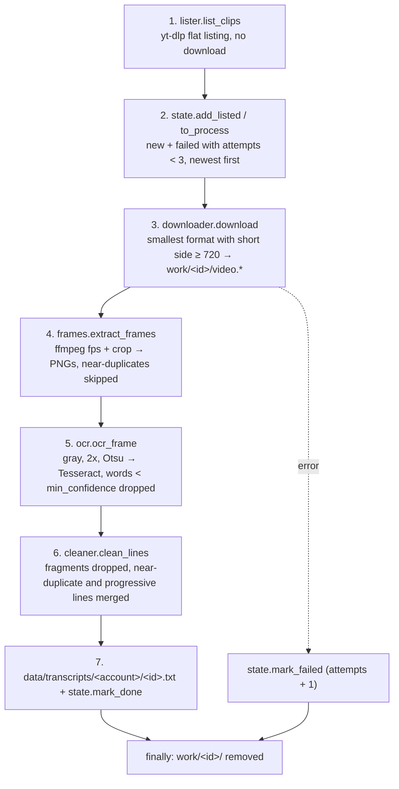
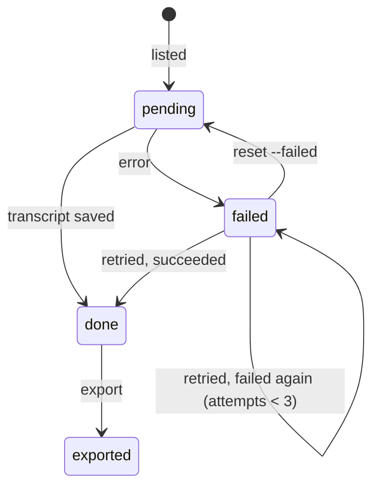

# Architecture

One CLI (`tiktok_ideas.py`) over a `pipeline/` package with one module per step. `runner.py` drives the per-clip loop; every step is a plain function, injected through `runner.Steps` so tests can swap in fakes.

## Per-clip flow

Leftover clip folders (`work/<numeric id>/`) are also removed at the start of every `run`, so an interrupted run leaves nothing behind for long. Only numeric folders are touched, so a mistaken `work_dir` can't wipe unrelated files.

## Clip states

A clip with 3 failed attempts stays `failed` and is skipped until `reset --failed`.

## Data

`data/state.db` (SQLite), table `clips`: `id` (TikTok id, time-ordered), `account`, `url`, `title`, `published`, `status`, `error`, `attempts`, `chars` (transcript length, used for the "low text" flag), `updated_at`.

Exports are `data/exports/<account>-<date>-<time>[-N].txt`: a TASK line for Claude, a `# @account | N clips | date` header, then `[id]` blocks. Parts are split at clip boundaries to stay under `export_max_chars`.

## Notes

- yt-dlp needs browser impersonation for TikTok (`curl_cffi`, config `impersonate: chrome`). yt-dlp's automatic target breaks profile listing, so a target is always set explicitly.
- `curl_cffi` has no wheels for 32-bit Python on Windows: use 64-bit Python.
- Frame de-duplication compares the busiest 20 px cell (on a 160 px-wide copy), not the whole-frame mean, so a one-word subtitle change on a static background still counts.
